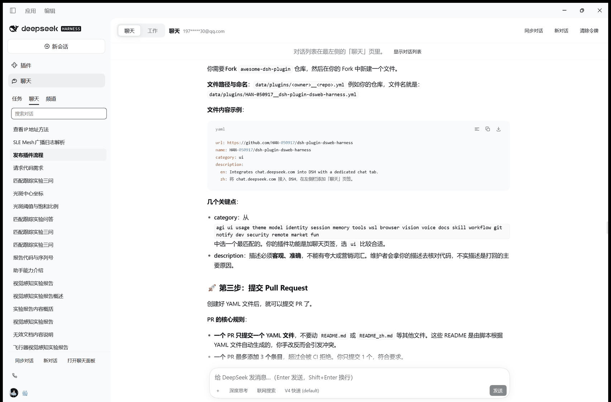

# DeepSeek 网页聊天 · DSH 插件

[](LICENSE)


把 **chat.deepseek.com**（DeepSeek 网页版）的对话记录同步进 DSH 的 Web 界面，并在同一个窗口里
直接继续聊天——不用再切到浏览器。左侧面板栏多出一个「聊天」图标，会话标题栏多出一个
**聊天 / 工作** 切换开关，和 ChatGPT 桌面版的 聊天 ⇄ 工作 是一个意思。


*聊天模式。会话记录住在**最左侧那一栏**的「聊天」页里（与「任务」「频道」并列），中间是对话正文，
左上角就是 **聊天 ⇄ 工作** 开关——切回工作，中间立刻换回 DSH 的 Agent 会话。*



*回答里的 fenced 代码块自带语言标题栏与一键下载，语法按语言着色（这里是 yaml），
行内代码同样高亮——和网页端看到的一致。*

```
┌─ 侧栏 ─┬────────────── 聊天面板 ──────────────┐
│  ▣ 插件 │  [ 聊天 | 工作 ]   ⟳ 同步  ＋ 新对话  │
│  ▤ 聊天 │  ┌───────────────────────────────┐  │
│         │  │  你: …                        │  │
│ 任务 聊天 │  │  DeepSeek: …                  │  │
│  搜索…   │  │  ▍ 生成中…                    │  │
│  会话 A  │  └───────────────────────────────┘  │
│  会话 B  │                                   │
└─────────┴───────────────────────────────────┘
   ↑ 会话列表在最左栏的「聊天」页里，和「任务」并列
```

- **聊天模式** = 这个插件面板，走你自己的 chat.deepseek.com 账号，历史记录与网页版一致。
- **工作模式** = DSH 原本的 Agent 会话（工具、文件、终端……），两者互不干扰。
- 切换只改变中间显示哪一栏，**不会**新建或销毁会话，来回切是瞬时的。

---

## 安装

三种装法，任选其一。装完都要**重启 DSH**：宿主半边是 ESM，只有新进程才会加载新的代际。

**① 插件市场（推荐）** —— 装一次市场，之后在 DSH 里「设置 → 插件市场」搜索本插件一键安装：

```bash
dsh plugin --profile web add dshmarket   # 需要 dsh web 0.1.0-rc.6 及以上
# 然后重启 dsh web
```

**② 命令行 / 插件页** —— 包名、Git 地址或本地目录都接受：

```bash
dsh plugin --profile desktop add dsh-deepseek-web-chat
# 或未发布到 npm 时直接指向仓库：
dsh plugin --profile desktop add github:HAN-050917/dsh-plugin-dsweb-harness
```

> 桌面版需先初始化一次 profile，并**完全退出**后再执行 `dsh plugin --profile desktop …`。
> 也可以让 DSH 里的 Agent 执行：`plugin_manager action=install_bundle target=<本仓库绝对路径>`。

**③ 本仓库开发** —— clone 后以 `link:` 方式挂进 profile（`dsh.profile.bundles`），
改代码就是改插件：客户端半边刷新页面即可生效，宿主半边（`lib/index.js`、
`lib/deepseek.js`）必须重启 DSH。没有构建步骤，`lib/client.js` 是手写产物、由宿主直接发布。

```bash
# 跑测试（19 个套件，零依赖）
node test-surface.mjs   # …test-*.mjs 都在包根目录
```

## 配置令牌（一次性）

插件需要你自己的网页版登录令牌才能读你的对话。令牌只存在本机，只用于向
`chat.deepseek.com` 发请求。

1. 浏览器打开并登录 <https://chat.deepseek.com>。
2. `F12` → **Console**，粘贴回车：

   ```js
   JSON.parse(localStorage.getItem('userToken')).value
   ```

3. 复制打印出来的令牌，切到 DSH 的「聊天」面板，粘贴进输入框，点 **保存并验证**。

输入框也接受整段 `Authorization: Bearer …`，或直接粘贴 `userToken` 的整段 JSON——会自动解开。

> **令牌会过期。** 过期后面板顶部会出现红色提示，按上面三步重新取一次即可。
> 点「清除令牌」会删除本机凭据文件（`~/.dsh/dsh-deepseek-web-chat/vault.json`，仅当前用户可读）。

---

## 功能

| 功能 | 说明 |
| --- | --- |
| 会话同步 | 拉取网页版的会话列表（最多 500 条），带标题与时间 |
| 历史回看 | 打开任一会话，读取完整的问答记录 |
| 本地缓存 | 最近 200 个会话落在本地缓存文件，离线也能看 |
| 继续聊天 | 在已有会话里接着发消息，网页版刷新后能看到（同一条会话） |
| 新建会话 | 「＋ 新对话」在 DeepSeek 侧建一个新会话再发消息 |
| 深度思考 / 联网搜索 | 对应网页版的两个开关 |
| 模型选择 | `default` / `expert` / `vision` |
| 流式输出 | 逐字返回；思考内容折叠显示在回答上方 |
| 自动续写 | 上游把长回答截断时（`INCOMPLETE` / `auto_continue`）自动调 `/chat/continue` 接着写，最多 8 轮 |
| 可中断 | 生成中点「停止」，会中断上游请求 |
| 添加附件 | 点 composer 左侧「＋」选择文件，或把文件拖到窗口任意位置；上传后可移除，也支持仅发送文件 |
| 文件大小限制 | 最多 10 个附件、单个 100 MB |
| 按文件内容追问 | 附件留在会话里：后续回合仍带上附件 ID，模型始终读得到文档内容（上游自己**不**保留文件） |
| 文件解析状态 | chip 显示 解析中… / 解析失败 / 文件大小；解析未完成时发送会被拦下（`409`） |
| 聊天气泡 | 提问靠右（气泡）、回答靠左（正文），一轮问答之间有留白与细分割线 |
| 侧栏「聊天」页签 | 侧栏 任务 / 频道 之间多一个「聊天」页签，专放网页版对话记录 |
| 只有一份列表 | 记录只住在**最左侧那一栏**的「聊天」页里，面板中间**不再**画第二份；面板会提示列表在哪并给一键切回 |
| 干净正文 | 搜索簿记与免责声明不混进正文；`[reference:N]` / `[citation:N]` 引用标记会被剥掉 |

---

## 架构

一个包、两个半边，靠 DSH 的 `dsh.bundle.patch` + `dsh.client` 同时挂载：

```
dsh-deepseek-web-chat/
├── package.json          # dsh.bundle.patch + dsh.client（platform: web）+ dsh-plugin 关键词
├── cordis.patch.yml      # 往 profile 里 insert 一行：id deepseek-web-chat
├── icon.svg              # 插件列表与市场里的图标
├── LICENSE               # MIT
├── screenshots.json      # 市场截图清单（相对路径）
├── lib/
│   ├── index.js          # 【Host 半边】HTTP 路由 + SSE 转发 + 本地缓存
│   ├── deepseek.js       # chat.deepseek.com 客户端（会话列表 / 历史 / 补全 / SSE 归约）
│   ├── pow.js            # DeepSeekHashV1 工作量证明（纯 JS，无依赖）
│   ├── vault.js          # 令牌保险箱（0600，原子写）
│   └── client.js         # 【浏览器半边】手写 lazy-CJS bundle，无构建步骤
├── locale/{zh,en}.json   # 插件列表里的显示名
├── tools/                # 开发期预览/提取脚本，不进包运行时
└── test-*.mjs            # 19 个零依赖测试套件
```

### 浏览器半边

`lib/client.js` 走 DSH 的 lazy-CJS 协议（`window.__ModuleLoader__.load({id, factory})`），
**没有构建步骤**，外部依赖只有平台自带的 `react`。它占了三个官方 slot：

| Slot | 作用 |
| --- | --- |
| `sidebar.panellist`（list，`id: 'deepseek-web-chat'`） | 左侧面板栏的图标 |
| `main`（keyed，`key: 'deepseek-web-chat'`） | 聊天面板本体 |
| `conversation.header.leading`（single，原本空着） | 标题前的 **聊天 / 工作** 开关 |

聊天模式下 conversation 表面被本插件的 `main` 面板取代，所以聊天面板**自己**也画一枚同样的开关，
位置必须与工作模式一致（贴在头部最左），否则一进聊天模式开关就跑到右边缘。

模式切换用的是 DSH 自己的原语：`ctx.layout.selectPanel('deepseek-web-chat')` 进聊天，
`selectPanel(null)` 回 Agent 会话。不需要任何 DOM 技巧，也不会盖掉自带界面。

**表面（surface）持久化**：聊天 / 工作是一个**独立的应用级表面轴**，既不等于 Agent 的工作模式，
也不挂在某个会话上。选择写进 localStorage，重载后回到你离开的那一面；每个模式各记一个位置
（`{sessionId}`），记的那个会话没了就开新对话；列表还没同步时把恢复**推迟到第一次同步成功之后**，
而不是靠猜。

快捷键：`Alt+1` = 聊天，`Alt+2` = 工作（macOS 用 `Ctrl+1/2`）。`shortcuts` 服务按需注入，
没有这个服务的组合里面板和开关照常工作。

**侧栏「聊天」页签（非官方挂载点，特性探测 + 优雅降级）**：侧栏的 `任务 | 频道` 这一行由第三方插件
`@michengai/dsh-im-connect` 接管后自己画出，并在 occupant 上挂了一个未公开的注册表。DSH 官方
**没有**在这一行插页签的 slot，所以这里做的是：从 `ctx.slots.entriesOfSlot('sidebar.workspaces')`
找 occupant → 读注册表 → 找得到就 `insert({ id, order: 10, label, render })`，找不到就什么都不做
（面板与开关完全不受影响）。同时监听 `dsh-native-sidebar-change` 事件以便它重建页签行后插回去。
页签只 connected，**不再**在中景画第二份列表。

### Host 半边

九条路由挂在 `/dsh-deepseek-web-chat` 前缀下：

| 方法 | 路径 | 说明 |
| --- | --- | --- |
| GET | `/state` | 令牌状态、用户信息、模型列表、缓存统计 |
| POST | `/token` | 校验并保存令牌 |
| POST | `/token/clear` | 删除令牌 |
| GET | `/sessions?count=&refresh=` | 会话列表（`refresh=0` 只读缓存） |
| GET | `/messages?sessionId=&refresh=` | 某个会话的全部消息 |
| POST | `/session/new` | 在 DeepSeek 侧新建会话 |
| POST | `/chat` | 发一条消息，SSE 流式返回（body 另可带 `refFileIds`、`attachments`、`detachFiles`） |
| POST | `/upload` | 接受单个文件原始字节，转发给 DeepSeek，返回解析 `status` |
| GET | `/files?file_ids=` | 查询已上传附件的状态 |

`/chat` 把本轮新挂的 `refFileIds` 与**该会话记忆的 ID** 合并后发给上游，并逐个核对：上游已不再列出的
ID（过期/被删）会被剔除；仍在解析的要等到终态，否则回 `409`。点 chip 的 × 则在下一轮带上
`detachFiles: true`，明确断开。

每条路由都自己过一遍同源检查（Host 必须是回环地址、拒绝 `sec-fetch-site: cross-site`、
Origin 要么没有要么与 Host 一致）。因为这是存 bearer 令牌的接口，不能只靠「在本地」就放心。

---

## 已知限制

- 只能读、写你自己账号里的会话——插件用的是你的网页版令牌，没有别的权限。
- DeepSeek 的网页接口没有公开文档，字段可能变；出错时面板会显示原文。
- 一个会话只有在**通过本插件发过消息**之后才会进本地缓存；纯网页版新开的会话要点一次「⟳ 同步对话」。
- 缓存是「最近 200 个会话」，更早的会从本地淘汰（网页版上还在）。
- 侧栏「聊天」页签挂的是 im-connect 的未公开注册表；它升级后若改名，页签会消失，
  但面板与 聊天/工作 开关不受影响（代码里是特性探测，不是硬依赖）。
- **改 Host 半边（`lib/index.js`、`lib/deepseek.js`）后必须重启 DSH**：ESM 模块缓存不会因为文件
  变动而重载。浏览器半边由 `dsh-client-hmr` 自动重载，无需重启。`/state` 会回一个 `protocol`
  版本号，客户端比对不一致时面板直接提示「插件后端仍是旧版本，请重启」。
- 同步来的思维链默认**折叠成一行**，点击展开；很长的思考展开后会比较占地方。

---

## 测试

19 个套件都在包目录里，全部离线、不需要令牌：

| 套件 | 钉住的行为 |
| --- | --- |
| `test-pow.mjs` | 4 个官方 DeepSeekHashV1 哈希向量 + 求解 + 请求头字段 |
| `test-sse.mjs` | 5 份真实抓包的 fragment 归类（思维链不混进正文） |
| `test-continue.mjs` | 真实截断样本必须续写、完成样本必须不续写 |
| `test-envelope.mjs` | 初始化信封里的正文不能丢 |
| `test-history.mjs` | 历史记录只取 REQUEST/RESPONSE，簿记不进正文 |
| `test-citations.mjs` | `stripCitations` 剥掉 `[reference:N]`（含跨 delta 的半个标记） |
| `test-search.mjs` | 联网搜索的 TOOL_SEARCH/TIP 不进正文 |
| `test-markdown.mjs` | markdown 渲染器 56 条断言（块级 / 行内 / 表格 / 任务列表 / 硬换行 / 代码卡三个工具按钮与彩色分词） |
| `test-think.mjs` | 推理行 29 条断言（折叠摘要、展开渲染、24px 行高） |
| `test-paging.mjs` | 会话列表翻页 15 条断言（游标闭区间去重、`has_more` 撒谎也不会转圈） |
| `test-i18n.mjs` | 中英字典（76 键）：无缺键/死键、两侧键集相同、没有绕过字典的硬编码文案 |
| `test-style.mjs` | 样式表只用真实主题 token、类名都有定义（60 个 token、100 个类） |
| `test-api.mjs` | `api()` 保留查询串（丢掉就报「缺少 sessionId」） |
| `test-chat-route.mjs` | 宿主路由 + 上传不被已读完的 `request.signal` 误取消 + 停止按钮中止上游 + 解析未完成 409 + 会话记住附件 + 协议版本一致 |
| `test-panel.mjs` | 列表归属（页签注册后中间不再有第二份列表）+ 整窗拖放守卫 + 页签按钮解析 |
| `test-tab-sync.mjs` | 侧栏页签与表面 53 条断言：只修「任务/聊天」这一对、让给别家页签、只有 `isTrusted` 点击算意图、定时器可拆 |
| `test-surface.mjs` | 聊天/工作表面 60 条断言：持久化、幂等、以真实面板为准的对齐、每面各自位置记忆 |
| `test-load.mjs` | 整个客户端 bundle 用真实 loader 完整求值一次，再对最小 `ctx` 调一次 `apply()` |
| `test-render.mjs` | 真组件真的画一遍 19 条断言（各状态 chip / 完整对话 / 令牌卡片 / 两个侧栏座位）+ 误用 `t()` 的静态扫描 |

`test-i18n.mjs` 值得单独说一句：`ctx.locale.bind(NS)` 在缺键时**返回键名本身而不抛错**，
所以少一个键的后果是界面上出现 `think.title` 这样的字样，而不是一条报错——另外两套测试都看不见它。
它同时抓「硬编码兜底文案」（英文界面下漏出中文的写法）。

---

## 卸载

```powershell
# 在 DSH 里：
#   plugin_manager action=remove_bundle target=dsh-deepseek-web-chat
```

再手动删掉 `~/.dsh/dsh-deepseek-web-chat/`（里面是令牌和缓存）。

---

## 许可证

[MIT](LICENSE)
