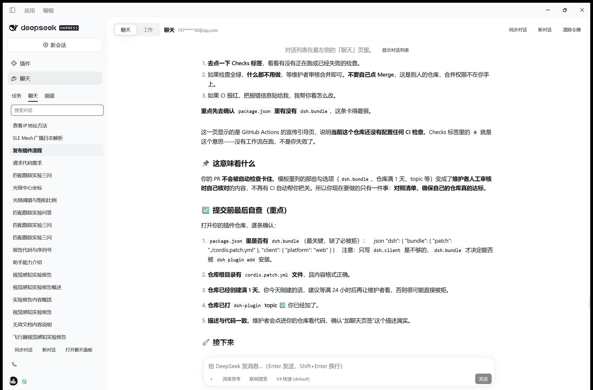
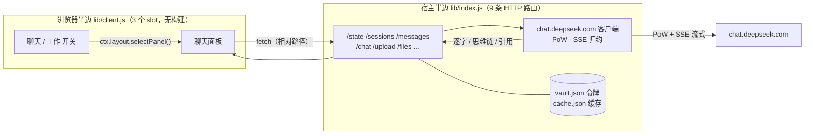

<div align="center">


# DeepSeek 网页聊天 · DSH 插件

**把 chat.deepseek.com 搬进 DSH（DeepSeek Harness）——历史记录、深度思考、联网搜索、文件解析，一个窗口里直接用。**

[](LICENSE)


</div>

---

## 这是什么

DSH 的强项是「工作模式」：Agent 会读文件、跑命令、改代码。但有些时候你只是想**聊天**——
问一个问题、贴一段文档、接着上次的话题往下聊。这时你需要的不是工具链，而是你熟悉的那个
DeepSeek 网页版。

这个插件把网页版**接进 DSH**：

- 左侧面板栏多一个「聊天」图标，会话标题栏多一个 **聊天 / 工作** 开关；
- 打开聊天，你看到的是**你账号里真实的对话**——和浏览器里打开 chat.deepseek.com 是同一份记录；
- 在这里发消息，网页版刷新后就能看到；网页版里聊的，点一下「⟳ 同步对话」就进来了；
- 切回工作模式，Agent 会话原封不动，来回切是瞬时的。

> **不是 iframe 套壳，也不是第三方代理。** 插件用你自己的网页版令牌，直接调用
> chat.deepseek.com 的真实接口：PoW 工作量证明、multipart 文件上传、SSE 流式归约，
> 全部按网页客户端的协议实现——所以历史记录互通、格式一致、模型能力一致。

---

## 界面



*聊天模式。会话记录住在**最左侧那一栏**的「聊天」页里（与「任务」「频道」并列），中间是对话正文，
右上角就是 **聊天 ⇄ 工作** 开关——切回工作，中间立刻换回 DSH 的 Agent 会话。*

下面是同一套布局的结构示意：

```
┌─ 侧栏 ─┬────────────── 聊天面板 ──────────────┐
│  ▣ 插件 │  [ 聊天 | 工作 ]   ⟳ 同步  ＋ 新对话  │
│  ▤ 聊天 │ ┌─────────┬───────────────────────┐ │
│         │ │ 搜索…    │  你: …                │ │
│         │ │ 会话 A   │  DeepSeek: …          │ │
│         │ │ 会话 B   │  ▍ 生成中…            │ │
│         │ └─────────┴───────────────────────┘ │
└─────────┴─────────────────────────────────────┘
   ↑ 插件自己画的图标            ↑ 聊天⇄工作 开关（也在 Alt+1 / Alt+2）
```

**聊天模式** = 这个面板，走你的 DeepSeek 账号；**工作模式** = DSH 原本的 Agent 会话。
切换只改变中间显示哪一栏，不新建、不销毁、不丢生成中的回答。

---

## 亮点

| | |
| --- | --- |
| 🔁 **聊天 ⇄ 工作，同构 ChatGPT 桌面版** | 表面轴独立于会话持久化、切换幂等、「先持久化再导航」、**每个模式各记一个位置**（回到聊天时重开你上次那个会话；那个会话没了就老实开新对话，绝不回到过期线程）。点击、命令面板、`Alt+1/2`（macOS `Ctrl+1/2`）三条入口同一段逻辑 |
| 📄 **文档真的能被读懂** | 上传 Word/PDF/PPT/Excel 后可以**一直追问**。上游其实不把文件存进会话（实测：追问坐标时模型会说「当前对话中没有包含这两点的图像数据」），所以由 Host 按会话记住附件 ID 并在每轮重发——你在 composer 里看得见这些 chips，点 × 就断开 |
| 🎨 **和 Agent 模式一样的排版** | 手写 markdown 渲染器：代码块**彩色分词**（颜色直接取自主题的 shiki 变量，跟随亮/暗）、三个工具按钮（换行/复制/下载）、思维链折叠成一行、引用标记剥掉、CJK 软换行 |
| 📎 **拖进去就行** | 整窗投放提示，多文件逐个上传；上传进度分「解析中… / 已解析 / 解析失败」，没解析完不允许发送（返回 409 说明原因），不再出现「发出去了却一片空白」 |
| 🧩 **零依赖、无构建** | 唯一外部依赖是平台自带的 React。没有打包器、没有 `node_modules` 运行时、没有构建步骤——`lib/client.js` 就是产物 |
| 🛡 **出错也看得见** | 上游返回的非 SSE 拒绝信封会被翻译成明确的错误；面板外层是 React 错误边界，**渲染异常只影响这块面板**，还能一键重画；host/client 协议号不一致时直接提示「请重启」，不会假装正常 |

---

## 功能一览

| 类别 | 能力 |
| --- | --- |
| 会话 | 同步列表（最多 500 条，游标翻页取全）、打开历史、本地缓存最近 200 个会话、离线可看、新建会话、继续聊天（网页版同一会话） |
| 生成 | 流式逐字、深度思考（默认折叠）、联网搜索、模型 `default` / `expert` / `vision`、长回答被截断时自动续写（最多 8 轮）、随时中断 |
| 附件 | 「＋」选择或**整窗拖放**、多文件（≤10 个、单个 ≤100 MB）、解析状态可见、按文件内容追问、可移除、可只发文件不发文字 |
| 界面 | 侧栏「聊天」页签（与任务/频道并列，会话列表只住这一处）、聊天⇄工作开关（切换时侧栏自动跟着切到对应页签）、会话搜索、气泡布局与清晰的问答分隔、中英双语、跟随主题亮暗 |
| 工程 | 宿主 9 条 HTTP 路由 + 浏览器半边 3 个官方 slot、SSE 转发、`cache.json` / `vault.json` 本机存储、19 个测试套件 |

---

## 安装

三种方式任选，**装完请重启 DSH**（宿主半边是 ESM，只有新进程才会加载新的代码代际）。

**① 插件市场（推荐）**

```bash
dsh plugin --profile web add dshmarket   # 需要 dsh web ≥ 0.1.0-rc.6
# 重启 dsh web，然后在 DSH「设置 → 插件市场」搜索 DeepSeek 网页聊天
```

**② 命令行**

```bash
dsh plugin --profile desktop add dsh-deepseek-web-chat
# 尚未发 npm 时，也可以直接指向仓库或本地目录：
dsh plugin --profile desktop add github:HAN-050917/dsh-plugin-dsweb-harness
dsh plugin --profile desktop add /abs/path/to/dsh-deepseek-web-chat
```

> 桌面版请先初始化一次 profile，并**完全退出 DSH** 后再执行 `dsh plugin --profile desktop …`。
> 也可以让 DSH 里的 Agent 代劳：`plugin_manager action=install_bundle target=<本目录绝对路径>`。

**③ 本地开发**：以 `link:` 挂进 profile，改代码即改插件（浏览器半边刷新页面生效，宿主半边需重启 DSH）。

## 配置令牌（一次性）

插件只读你自己的对话，令牌只存在本机，只用于向 `chat.deepseek.com` 发请求。

1. 浏览器登录 <https://chat.deepseek.com>；
2. `F12` → Console → 粘贴回车：

   ```js
   JSON.parse(localStorage.getItem('userToken')).value
   ```

3. 复制结果，粘到 DSH 聊天面板的设置卡片里，点 **保存并验证**。

也接受整段 `Authorization: Bearer …` 或完整的 `userToken` JSON（会自动解开）。
令牌过期时面板顶部会亮红色提示，重复上面三步即可；「清除令牌」会删除本机文件。

存放位置：`%USERPROFILE%\.dsh\dsh-deepseek-web-chat\vault.json`（仅当前用户可读）。

---

## 它是怎么工作的



- **模式切换**用 DSH 自己的原语 `ctx.layout.selectPanel('deepseek-web-chat')` / `selectPanel(null)`，
  不碰 DOM、不盖掉自带界面；
- **上传**由宿主申请专属 PoW 挑战、multipart 提交、轮询到可用；返回**真实解析状态**而不是傻等，
  解析没完成时发送会被明确拦下；
- **可信来源**：网页版的每个接口、字段名、状态机都是从真实客户端抓包与逆向中确认的，
  连「拒绝时返回的是裸 JSON 信封而不是 SSE」这种细节都写进了测试。

---

## 设计取舍（为什么长这样）

| 取舍 | 原因 |
| --- | --- |
| 手写 markdown 渲染器与分词器 | 平台只提供 React；引入 shiki/remark 就要构建链。手写换来零依赖，代价是语言表要自己维护（已覆盖 20+ 语言，未收录的也保证逐字符原样输出） |
| 附件 ID 由 Host 按会话记住 | 上游不把文件存进会话；网页版靠「附件跟着对话走」，这里用 `cache.files` 复刻同样的体验，并给出显式的「断开」动作 |
| 两半各自报 `protocol` 版本 | 宿主半边要重启才生效、浏览器半边热重载，容易「一半是新的」。版本不一致时面板直接说「请重启」，比让你对着一个 400 猜半天好 |
| 面板状态放在 React 之外 | 切换模式会让面板卸载；把会话、草稿、进行中的请求放在模块级 store 里，切回来一切都还在 |
| 整窗接管拖放 | 只挂在面板上时，拖到面板以外没人 `preventDefault()`，浏览器会把本地文件当导航目标打开——整页白屏。现在由面板在捕获阶段接管整窗 |

---

## 隐私与安全

- 令牌只写在**本机** `vault.json`（用户级权限），插件不会把它发往 `chat.deepseek.com` 以外的任何地方；
- 仓库里**没有任何凭据**，测试全部离线运行、不需要令牌；
- 权限等同于你的网页版会话本身——**只能读写你自己账号里的对话**；
- 上游接口没有公开文档，字段可能变化；出错时面板显示原文，不吞异常。

---

## 已知限制

- 上游不保存会话附件（见上），断开的动作是显式的；单文件 100 MB、最多 10 个附件。
- 纯网页版新开的会话，要在插件里点一次「⟳ 同步对话」才会进本地缓存；缓存保留最近 200 个会话。
- 同步来的思维链默认折叠；很长的思考展开后比较占地方。
- 侧栏「聊天」页签挂在第三方插件（im-connect）的未公开注册表上，它改名时页签会消失，
  但面板与 聊天/工作 开关不受影响（代码是特性探测，不是硬依赖）。
- 改宿主半边（`lib/index.js`、`lib/deepseek.js`）后必须重启 DSH；浏览器半边刷新即可。

## 环境要求

| | |
| --- | --- |
| DSH | ≥ `0.2.0-rc.2`（`package.json` 里用预发布分支区间声明） |
| Node | `^22.19.0 \|\| >=24.0.0` |
| 账号 | 任意 DeepSeek 网页版账号（插件使用你自己的令牌） |
| 依赖 | 运行时零依赖（仅平台提供的 React） |

## 开发与测试

```bash
node --check lib/index.js && node --check lib/client.js && node --check lib/deepseek.js
for f in test-*.mjs; do node "$f" || echo "FAIL $f"; done   # 19 个套件，全离线
```

测试不是摆设：SSE 归约、历史解析、续写判定、翻页游标、i18n 完整性、样式 token 白名单、
「同一份列表不同时出现两次」、**侧栏页签与模式永不漂移**（双向认领、只认真实点击、频道不碰）、
整窗拖放、以及**真组件真的画一遍**（含「厂级作用域误用 `t()`」
的静态扫描）。你想改哪一块，先看它被哪个套件钉住。

发布到 GitHub / npm / 插件市场的步骤见 [PUBLISHING.md](PUBLISHING.md)。

## 许可证

[MIT](LICENSE)
